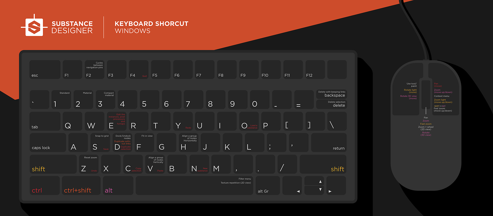
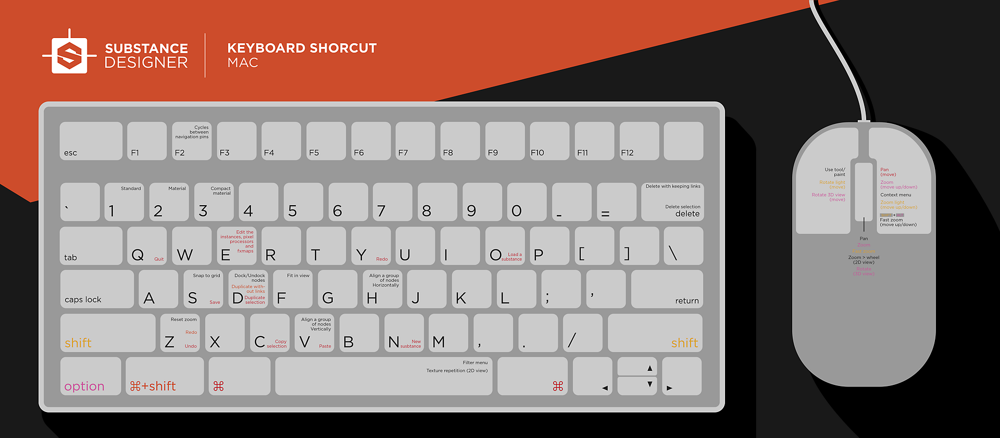

# 단축키

이 페이지에서는 Substance 3D Designer에 대한 모든 단축키의 개요를 찾을 수 있습니다.

## 키맵

**Windows**

{zoomable="yes"}

**macOS**

{zoomable="yes"}

## 단축키 목록

### 글로벌

| 액션 | Windows | macOS |
|:------------------------|:-------------|:-------------|
| 새 Substance 그래프 | Ctrl + N | ⌘ + N |
| 패키지 로드 | Ctrl + O | ⌘ + O |
| 패키지 저장 | Ctrl + S | ⌘ + S |
| 모든 패키지 저장 | Ctrl + ⇧ + S | ⌘ + ⇧ + S |
| 실행 취소 | Ctrl + Z | ⌘ + Z |
| 다시 실행 | Ctrl + Y | ⌘ + Y |
| 상황별 메뉴 | RMB | RMB |
| 도크 최대화 | ⇧ + 스페이스바 | ⇧ + 스페이스바 |
| 스위치 엔진 | F9 | F9 |
| 엔진 일시 중단 | ⇧ + Escape | ⇧ + Escape |

{style="table-layout:fixed"}

### 그래프 보기

**뷰포트**

| 액션 | Windows | macOS |
|:----------------------|:---------------------------------------|:-------------------------------------|
| 확대/축소 | 마우스 휠 Alt + RMB + 드래그 | 마우스 휠 ⌥ + RMB + 드래그 |
| 빠른 확대/축소 | ⇧ + 마우스 휠 ⇧ + Alt + RMB + 드래그 | ⇧ + 마우스 휠 ⇧ + ⌥ + RMB + 드래그 |
| 패닝 | MMB + 드래그 Ctrl + RMB + 드래그 | MMB + 드래그 ⌘ + RMB + 드래그 |
| 확대/축소 재설정 | Z | Z |
| 보기에 맞추기 | F | F |
| 복사 | Ctrl + C | ⌘ + C |
| 붙여넣기 | Ctrl + V | ⌘ + V |
| 검색 | Ctrl + F | ⌘ + F |
| 노드 메뉴 | 스페이스바 | 스페이스바 |
| 순환 탐색 핀 | F2 | F2 |

{style="table-layout:fixed"}

**선택**

| 액션 | Windows | macOS |
|:--------------------------|:-------------------|:---------------|
| [추가] 선택 | Ctrl + A | ⌘ + A |
| 선택 항목 전환 | Ctrl + LMB | ⌘ + LMB |
| 윤곽 선택(추가) | Ctrl + LMB + 드래그 | ⌘ + LMB + 드래그 |
| 선택 윤곽 선택(빼기) | Shift + LMB + 드래그 | ⇧ + LMB + 드래그 |

{style="table-layout:fixed"}

**선택한 항목**

| 액션 | Windows | macOS |
|:------------------------------------|:-------------|:----------|
| 선택 영역 복사 | Ctrl + C | ⌘ + C |
| 선택 항목 복제 | Ctrl + D | ⌘ + D |
| 링크 없이 복제 | Ctrl + ⇧ + D | ⌘ + ⇧ + D |
| 선택 항목 삭제 | 삭제 | 삭제 |
| 선택 영역 삭제 및 링크 유지 | ⌫ | ⌫ |
| 노드 고정/고정 해제 | D | D |
| 보기에 맞추기 | F | F |
| 참조된 그래프 열기 | ⌘ + E | ⌘ + C |
| 가로 노드 맞춤 | H | H |
| 노드를 세로로 정렬 | V | V |
| 격자에 노드 스냅 | S | S |

{style="table-layout:fixed"}

**노드 연결**

| 커넥터에 대한 작업 | Windows | macOS |
|:---------------------|:-----------|:--------|
| 연결 이동 | ⇧ + LMB | ⇧ + LMB |
| 동일한 소스에서 새로 만들기 | Ctrl + LMB | ⌘ + LMB |
| 연결 삭제 | Alt + LMB | ⌥ + LMB |

{style="table-layout:fixed"}

| 링크에 대한 작업 | Windows | macOS |
|:---------------------------------|:----------|:--------|
| 링크 전환(한 번에 2개의 링크) | X | X |
| 점 노드 추가 | Alt + LMB | ⌥ + LMB |

{style="table-layout:fixed"}

#### 그래프만 Substance

| 액션 | Windows | macOS |
|:--------------------------------|:----------|:--------|
| 2D 보기에서 빠른 보기(노드) | Alt + LMB | ⌥ + LMB |
| 노드 비활성화 | ⇧ + D | ⇧ + D |
| 그래프 출력 내보내기 | Ctrl + B | ⌘ + B |
| 노드 캐시 지우기 | F5 | F5 |
| 그래프 렌더링 취소 | Escape | Escape |

{style="table-layout:fixed"}

| 링크 생성 모드 | Windows | macOS |
|:--------------------|:--------|:------|
| 표준 | 1 | 1 |
| 재질 | 2 | 2 |
| 컴팩트 재질 | 3 | 3 |

{style="table-layout:fixed"}

>[!NOTE]
>
> 이 설명서의 [이 페이지](../../interface/the-graph-view/link-creation-modes/link-creation-modes.md)에서 링크 만들기 모드에 대해 알아보세요.

### 2D 보기

| 액션 | Windows | macOS |
|:---------------------|:---------------------------------------|:-------------------------------------|
| 확대/축소 | 마우스 휠 Alt + RMB + 드래그 | 마우스 휠 ⌥ + RMB + 드래그 |
| 빠른 확대/축소 | ⇧ + 마우스 휠 ⇧ + Alt + RMB + 드래그 | ⇧ + 마우스 휠 ⇧ + ⌥ + RMB + 드래그 |
| 패닝 | MMB + 드래그 Ctrl + RMB + 드래그 | MMB + 드래그 ⌘ + RMB + 드래그 |
| 100% 배율로 재설정 | Z | Z |
| 보기에 맞추기 | F | F |
| 타일식 표시 전환 | 스페이스바 | 스페이스바 |

{style="table-layout:fixed"}

### 3D 보기

| 액션 | Windows | macOS |
|:-----------------------------------------------------|:--------------------------------|:-----------------------------|
| 돌리 카메라(앞/뒤 팬) | 마우스 휠 Alt + RMB + 드래그 | 마우스 휠 ⌥ + RMB + 드래그 |
| 궤도 카메라 | LMB + 드래그 | LMB + 드래그 |
| 트럭 및 페데스탈 카메라 (측면 및 수직 팬) | MMB + 드래그 Ctrl + RMB + 드래그 | MMB + 드래그 ⌘ + RMB + 드래그 |
| 환경 회전 | Ctrl + ⇧ + RMB | Ctrl + ⇧ + RMB |
| 일시적으로 포인트 라이트 1 컨트롤로 전환 | ⇧(고정) | ⇧(고정) |
| 궤도 지점 조명 1 | LMB + 드래그 | LMB + 드래그 |
| 돌리 포인트 라이트 1 | RMB + 드래그 | RMB + 드래그 |
| 렌더링 저장 | Alt + S | ⌥ + S |
| 클립보드에 렌더링 복사 | Alt + C | ⌥ + C |
| 카메라 위치 재설정 | R | R |
| 카메라 상태 재설정 | ⇧ + R | ⇧ + R |
| 망 선택(래스터화 및 GPU 패스트레이서 전용) | ⇧ + LMB | ⇧ + LMB |
| 프레임 선택 | F | F |

{style="table-layout:fixed"}

### 탐색기

| 액션 | Windows | macOS |
|:----------------------------------|:----------|:-------|
| 선택한 패키지 닫기 | Ctrl + F4 | ⌘ + W |
| 패키지/리소스 다시 로드 | Ctrl + R | ⌘ + R |
| 리소스 이름 바꾸기 | F2 | F2 |
| 리소스 삭제 | 삭제 | 삭제 |
| 편집기/뷰어에서 리소스 로드 | Enter | Enter |
| Publish에서 SBSAR로 선택한 패키지 | Ctrl + P | ⌘ + P |

{style="table-layout:fixed"}
